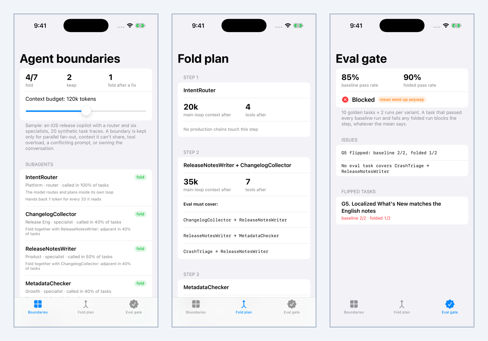
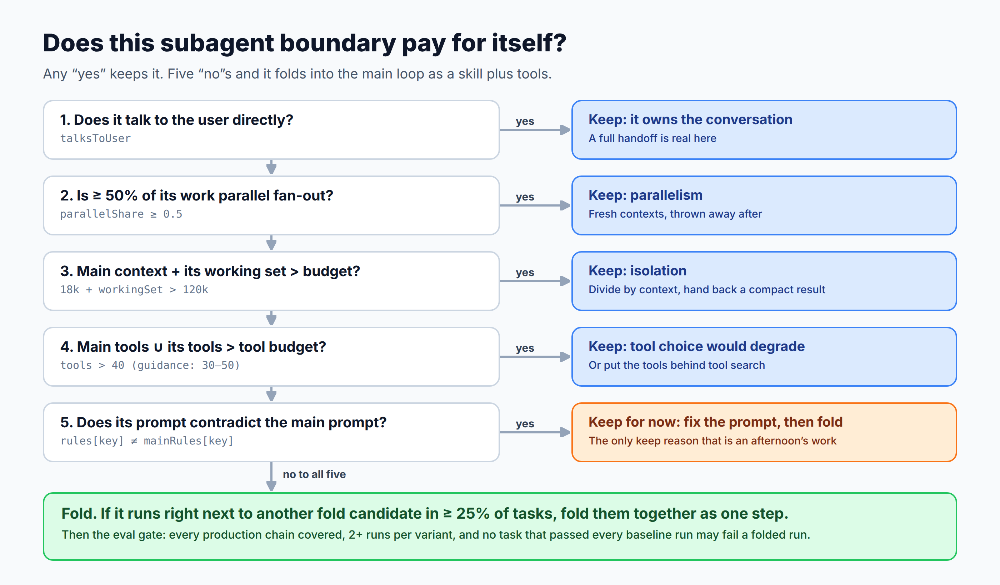
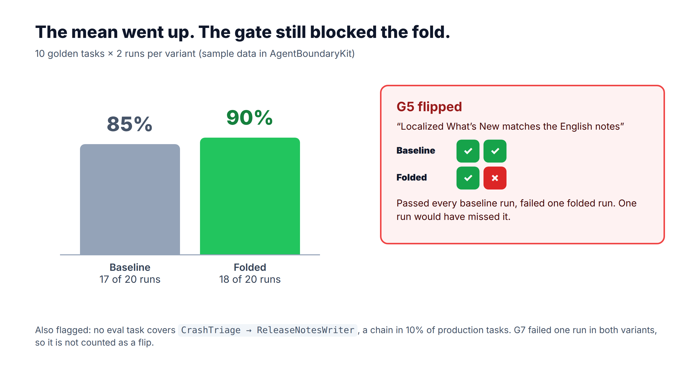

# AgentBoundaryKit

**Which of your subagents should fold back into the main agent loop?** A Swift package that scores each subagent boundary the way an iOS lead scores a module boundary, plans the folds, and gates each one with an eval that looks at flipped tasks instead of the mean. Includes an iOS demo app.

Article: [Anthropic Says Fold Your Subagents Back In. I Scored Seven Like Swift Modules, and Four Should Go.](https://medium.com/@er.rajatlakhina/anthropic-says-fold-your-subagents-back-in-i-scored-seven-like-swift-modules-and-four-should-go-e36339578148) (Medium)



## The idea

A boundary is worth its coordination cost only when it buys **isolation**, **parallelism** or **ownership**. Anthropic's guidance ([Building agents: When to fold subagents into your main agent loop](https://claude.com/resources/articles/building-agents-when-to-fold-subagents-into-your-main-agent-loop), 22 Oct 2026) keeps subagents for context bloat, parallel fresh-context work, and tool or instruction conflicts. `BoundaryRubric` turns that into five checks:

| Check | Keep reason |
|---|---|
| Talks to the user directly | `.ownsConversation` |
| ≥ 50% of calls are parallel fan-out | `.parallelFanOut` |
| Main context + working set > context budget (120k) | `.contextBloat` |
| Main tools ∪ its tools > tool budget (40) | `.toolSelection` |
| Prompt contradicts the main prompt | `.conflictingInstructions` (fixable) |

No reason to keep → **fold**. If it runs right next to another fold candidate in ≥ 25% of tasks, they fold together as one step.



## What's in it

- `Topology`, `AgentSpec`, `TaskTrace`, `Invocation`: the coordinator, its subagents, and recorded calls.
- `TraceStats`: call share, parallel share, adjacent-pair share (routers and planners excluded, fan-out collapsed to one step), entity overlap, mean handoff size.
- `BoundaryRubric` → `[BoundaryAssessment]` with a `Verdict` (`.fold`, `.foldWith`, `.keep([KeepReason])`) and the numbers behind it, including how many raw tokens each agent reads per token it hands back.
- `FoldPlan`: most-used first, coupled pairs as one step, budgets checked **cumulatively** (the per-agent check can't see the sum), and the production chains each step's eval must cover.
- `FoldGate`: blocks a step if any task that passed every baseline run fails a folded run, if a production chain has no eval task, or if any task has fewer than 2 runs per variant. The mean is reported, never decisive.
- `SampleReleaseCopilot`: a constructed iOS release copilot (router + six specialists, 20 **synthetic** traces, 10 golden tasks × 2 runs).

```swift
let assessments = BoundaryRubric().assess(topology: topology, traces: traces)
let plan = FoldPlan.make(topology: topology, traces: traces, assessments: assessments)
let report = FoldGate(tasks: evalTasks).evaluate(results: results, productionChains: chains)
report.canShip            // false
report.meanHidesRegression // true: 85% → 90%, and G5 still flipped
```

On the sample: 4 of 7 fold (IntentRouter, ChangelogCollector + ReleaseNotesWriter as a pair, MetadataChecker). CrashTriage stays (158k folded context > 120k), LocalizationReviewer stays (100% parallel fan-out), ReviewReplyDrafter stays until its `tone` rule stops contradicting the main prompt. The gate blocks the fold: pass rate goes from 85% to 90%, but G5 passed 2/2 baseline runs and 1/2 folded, and no eval task covers `CrashTriage → ReleaseNotesWriter`.



## How to run it

```bash
git clone https://github.com/rajatslakhina/fold-subagents-article-demo.git
cd fold-subagents-article-demo
open Demo.xcodeproj   # pick an iPhone Simulator, then Build & Run (⌘R)
```

No other setup: `Demo.xcodeproj` uses the package in this repo through a local package reference. The Boundaries tab has a context-budget slider; drag it to 200k and CrashTriage folds too.

Library only:

```bash
swift build && swift test
```

## Verification status

- `swift build -Xswiftc -warnings-as-errors` and `swift test` (29 tests, 0 failures) pass on Linux (Swift 6.1.2), and in the `library` CI job on macOS.
- The `demo-on-simulator` CI job builds `Demo.xcodeproj` for an iPhone Simulator, installs and launches the app four times with a process-alive check, and commits the screenshots in `Demo/Screenshots/`. It is not a hand-run in local Xcode.
- Latest CI run: [41411346162](https://github.com/rajatslakhina/fold-subagents-article-demo/actions/runs/41411346162) on `b97ff69`, both jobs green.

## License

MIT
